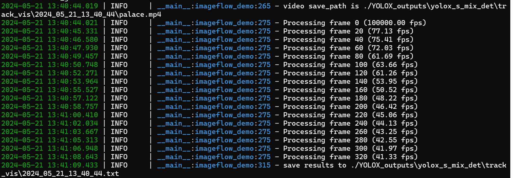
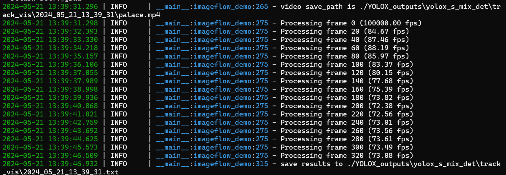

# YOLOX-Bytetrack Algorithm Optimization with CuPy

#### This repository contains an optimized version of the YOLOX-Bytetrack algorithm.

## Abstract
The primary enhancement involves the use of CuPy instead of NumPy for the `preproc` function, resulting in significant performance improvements for the preprocessing stage. The changes also include the utilization of multithreading for parallel processing of multiple images.

## Key Improvements
### 1. CuPy Integration
The original `preproc` function used NumPy for various operations, which are now replaced with CuPy to leverage GPU acceleration. This change drastically reduces the preprocessing time, especially when dealing with large batches of images.

**Original `preproc` Function**
```python
def preproc(image, input_size, mean, std, swap=(2, 0, 1)):
    if len(image.shape) == 3:
        padded_img = np.ones((input_size[0], input_size[1], 3)) * 114.0
    else:
        padded_img = np.ones(input_size) * 114.0
    img = np.array(image)
    r = min(input_size[0] / img.shape[0], input_size[1] / img.shape[1])
    resized_img = cv2.resize(
        img,
        (int(img.shape[1] * r), int(img.shape[0] * r)),
        interpolation=cv2.INTER_LINEAR,
    ).astype(np.float32)
    padded_img[: int(img.shape[0] * r), : int(img.shape[1] * r)] = resized_img

    padded_img = padded_img[:, :, ::-1]
    padded_img /= 255.0
    if mean is not None:
        padded_img -= mean
    if std is not None:
        padded_img /= std
    padded_img = padded_img.transpose(swap)
    padded_img = np.ascontiguousarray(padded_img, dtype=np.float32)
    return padded_img, r
```

**Optimized preproc Function with CuPy**   
```python
def preproc_with_cupy(image, input_size, mean, std, swap=(2, 0, 1)):
    device = cp.cuda.Device(0)
    device.use()

    if len(image.shape) == 3:
        padded_img = cp.ones((input_size[0], input_size[1], 3)) * 114.0
    else:
        padded_img = cp.ones(input_size) * 114.0

    img = cp.array(image)
    r = min(input_size[0] / img.shape[0], input_size[1] / img.shape[1])

    target_height = int(img.shape[0] * r)
    target_width = int(img.shape[1] * r)

    if target_height <= 0 or target_width <= 0:
        raise ValueError(f"Invalid target size: ({target_width}, {target_height})")

    resized_img = cp.array(cv2.resize(
        cp.asnumpy(img),
        (target_width, target_height),
        interpolation=cv2.INTER_LINEAR,
    ).astype(np.float32))

    if len(image.shape) == 3:
        padded_img[:target_height, :target_width, :] = resized_img
    else:
        padded_img[:target_height, :target_width] = resized_img

    padded_img = padded_img[:, :, ::-1] / 255.0  # BGR to RGB and normalize

    if mean is not None:
        mean_array = cp.array(mean).reshape(1, 1, 3)
        padded_img -= mean_array

    if std is not None:
        std_array = cp.array(std).reshape(1, 1, 3)
        padded_img /= std_array

    padded_img = padded_img.transpose(swap)
    padded_img = cp.ascontiguousarray(padded_img, dtype=cp.float32)
    return padded_img, r
```
### 2. Multithreading for Image Processing

To further enhance performance, the process_images method now uses multithreading to preprocess multiple images in parallel. This change utilizes Python's ThreadPoolExecutor to handle image preprocessing concurrently.

**Added process_images Method**  

```python
    def process_images(self, image_list, input_size, mean, std, swap=(2, 0, 1)):
        with ThreadPoolExecutor() as executor:
            futures= [executor.submit(preproc_with_cupy, img, input_size, mean, std, swap) for img in image_list]
            results = [future.result() for future in futures]
        if results:
            return results
```
## Result
The integration of CuPy and the use of multithreading have significantly improved the preprocessing time for image batches. Below is a comparison of the preprocessing time before and after the optimization:
The tests resulted in an FPS increase of around 1.5X-2X, depending on the graphics card used and the type of model.

**Before optimization**
<p align="center"></p>

**After optimization**
<p align="center"></p>
```

## Acknowledgement

A large part of the code is borrowed from [YOLOX](https://github.com/Megvii-BaseDetection/YOLOX), [FairMOT](https://github.com/ifzhang/FairMOT), [TransTrack](https://github.com/PeizeSun/TransTrack) and [JDE-Cpp](https://github.com/samylee/Towards-Realtime-MOT-Cpp). Many thanks for their wonderful works.
